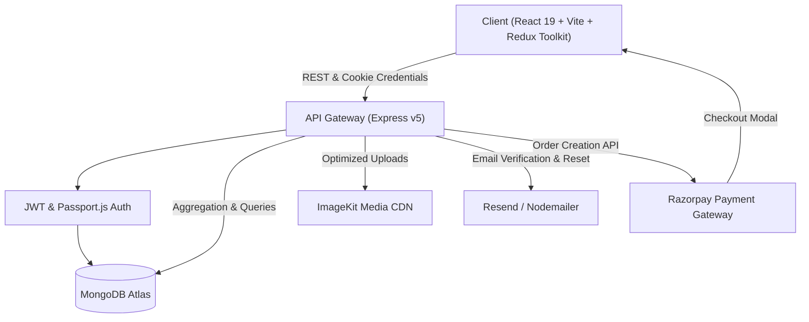

<div align="center">

# ⚜️ CLOTHINGG
### *Curated Fashion & Artisanal Luxury Marketplace*

[](https://react.dev/)
[](https://react.dev/)
[](https://nodejs.org/)
[](https://expressjs.com/)
[](https://www.mongodb.com/)
[](https://tailwindcss.com/)
[](https://razorpay.com/)

<p align="center">
  A modern, high-performance multi-vendor luxury fashion marketplace. Features role-based access control, complex multi-attribute product variants, CDN media pipelines, an animated interactive shopping bag, and Razorpay secured checkout.
</p>

[Explore Features](#-core-features) • [System Architecture](#-system-architecture) • [API Reference](#-api-reference) • [Installation Guide](#-getting-started) • [Roadmap](#-roadmap)

</div>

---

## 🌟 Overview

**CLOTHINGG** bridges high-fashion boutique aesthetics with enterprise-grade e-commerce engineering. Built on the **MERN** stack, it empowers **Sellers** to manage intricate multi-attribute inventory (size, color, localized pricing, stock, high-resolution CDNs) and provides **Buyers** with an editorial shopping experience complete with dynamic variant switching, an artisanal slide-over cart drawer, and seamless **Razorpay payment checkout**.

---

## 🏗️ System Architecture



---

## ✨ Core Features

### 🔐 1. Authentication & Role-Based Access Control
- **Dual Authentication Modes:** Email/password credentials or 1-click **Google OAuth 2.0** (Passport.js).
- **Secure Email Verification:** Tokenized verification links delivered via **Resend / Nodemailer**.
- **Cryptographic Security:** Passwords hashed with `bcrypt`, sessions authenticated via **JWT stored in HttpOnly cookies**.
- **Role Guards:** Strict routing barriers separating `Buyer` from `Seller` permissions, with seamless state rehydration on refresh.
- **Password Lifecycle:** Forgot password and tokenized password reset workflows.

### 🛍️ 2. Seller Hub & Variant Engine
- **Dedicated Dashboard:** Complete inventory oversight, product management, and stock tracking.
- **Complex Variant System:** Supports individual variant pricing, stock, custom attributes (Size, Color, Material), and separate multi-image galleries.
- **CDN Cloud Uploads:** High-performance memory storage handling via **Multer** and automated upload optimization to **ImageKit CDN**.

### 🎨 3. Luxury Buyer Experience
- **Editorial Fashion Storefront:** Aesthetic hero transitions, responsive product grids, and smooth animations using **Framer Motion**.
- **Dynamic Product Detail Page:** Real-time price updates and gallery changes on variant selection.
- **Buyer Account Management:** Profile management, customizable delivery addresses, and personalized settings.

### 🛒 4. Smart Shopping Bag (Cart System)
- **Slide-Over Cart Drawer:** Elegant, responsive drawer with live subtotal computations, complimentary shipping badges, and luxury packaging indicators.
- **MongoDB Aggregation Pipeline:** Optimized backend lookups matching populated variant data and calculating live totals.
- **Persistent Redux State:** Optimistic state handling with increment, decrement, and item removal actions.

### 💳 5. Razorpay Secured Checkout
- **Server-Side Order Generation:** Secure backend endpoint `/api/cart/payment/create/order` generating cryptographically signed Razorpay order IDs.
- **Interactive Checkout Modal:** Direct client-side invocation through Razorpay Checkout SDK with customer prefill and real-time payment handling.

---

## 🛠️ Technology Stack

| Layer | Technology | Version | Purpose |
| :--- | :--- | :--- | :--- |
| **Frontend** | React | `^19.2` | Core component architecture |
| | Vite | `^8.0` | Ultra-fast build tool and dev server |
| | React Router | `^7.18` | Declarative client-side routing & route guards |
| | Redux Toolkit | `^2.12` | Global state (Auth, Cart, UI) |
| | Tailwind CSS | `^4.3` | Modern utility styling |
| | Framer Motion | `^13.4` | Micro-interactions and drawer animations |
| | Axios | `^1.20` | HTTP client with cookie credentials |
| | React Hot Toast | `^2.6` | Elegant toast alerts |
| **Backend** | Node.js | `v18+` | Runtime environment |
| | Express.js | `^5.0` | Next-generation asynchronous web framework |
| | MongoDB & Mongoose | `^8.10` | Document database and schema modeling |
| | Passport.js | `^0.7` | Google OAuth 2.0 social authentication |
| | JSON Web Tokens | `^9.0` | Stateless authentication via HttpOnly cookies |
| | Zod | `^3.24` | Strict request validation schemas |
| | Razorpay SDK | `^2.9` | Payment order creation and verification |
| | Multer & ImageKit | `^1.4` / `^1.3` | Multi-file buffer uploads to cloud CDN |
| | Nodemailer & Resend | Latest | Transactional emails and verification |

---

## 🗺️ Application Routes

### Frontend Routes
| Access | Route | Component / View |
| :--- | :--- | :--- |
| **Public** | `/` | Home Redirect / Landing |
| **Public** | `/login` / `/register` | Buyer & Seller Authentication |
| **Public** | `/verify-email` / `/verify` | Account Verification |
| **Public** | `/forgot-password` / `/reset-password` | Password Recovery |
| **Public** | `/product/:productId` | Detailed Product & Variant View |
| **Seller** | `/seller-home` | Seller Dashboard |
| **Seller** | `/add-product` | Multi-Variant Product Creator |
| **Seller** | `/see-products` | Inventory Management Table |
| **Seller** | `/seller-profile` | Seller Account Settings |
| **Seller** | `/seller-product/:productId` | Product Editor & Variant Manager |
| **Buyer** | `/buyer-home` | Curated Fashion Storefront |
| **Buyer** | `/buyer-products` | Full Fashion Catalog with Filters |
| **Buyer** | `/buyer-profile` | Buyer Profile & Delivery Addresses |

---

## 📡 API Reference

### 🔑 Authentication (`/api/auth`)
| Method | Endpoint | Description | Access |
| :--- | :--- | :--- | :--- |
| `POST` | `/register` | Register new user (Buyer/Seller) | Public |
| `GET` | `/verify` | Verify email address token | Public |
| `POST` | `/login` | Authenticate user & issue HttpOnly JWT | Public |
| `POST` | `/forgot-password` | Trigger password reset email | Public |
| `POST` | `/reset-password` | Complete password reset | Public |
| `GET` | `/getMe` | Fetch current session user | Private |
| `GET` | `/google` | Initiate Google OAuth redirect | Public |
| `GET` | `/google/callback` | OAuth callback handler | Public |
| `POST` | `/logout` | Invalidate cookie & terminate session | Private |

### 👗 Product Catalog (`/api/products`)
| Method | Endpoint | Description | Access |
| :--- | :--- | :--- | :--- |
| `POST` | `/add` | Create base product with images | Seller Only |
| `POST` | `/:productId/variants` | Attach new variant to existing product | Seller Only |
| `GET` | `/sellerProduct` | Fetch all products owned by seller | Seller Only |
| `DELETE` | `/delete` | Delete product and its variants | Seller Only |
| `GET` | `/getAllProducts` | Browse marketplace products | Public |
| `GET` | `/DetailedProduct/:productId` | Fetch detailed product metadata & variants | Public |

### 🛒 Cart & Payments (`/api/cart`)
| Method | Endpoint | Description | Access |
| :--- | :--- | :--- | :--- |
| `POST` | `/add/:productId` | Add item without variant to cart | Private |
| `POST` | `/add/:productId/:variantId` | Add specific product variant to cart | Private |
| `GET` | `/get` | Fetch buyer cart with aggregated calculations | Private |
| `PATCH` | `/quantity/increase/:productId/:variantId?`| Increment item quantity (+1) | Private |
| `PATCH` | `/quantity/decrease/:productId/:variantId?`| Decrement item quantity (-1) | Private |
| `DELETE` | `/remove/:productId/:variantId?` | Remove item from cart | Private |
| `POST` | `/payment/create/order` | **Generate Razorpay order for cart checkout** | Private |

---

## 📁 Repository Structure

```
CLOTHINGG/
├── backend/
│   ├── src/
│   │   ├── config/              # Centralized environment configuration
│   │   ├── controller/          # Request handlers (auth, product, cart)
│   │   ├── DAO/                 # Data access layer
│   │   ├── middleware/          # JWT auth & role validation guards
│   │   ├── model/               # Mongoose schemas (user, product, cart)
│   │   ├── routes/              # Express route routers
│   │   ├── services/            # Payment (Razorpay), CDN (ImageKit), Mail
│   │   ├── validation/          # Zod schema definitions
│   │   └── app.js               # Express application initialization
│   ├── .env                     # Server environment secrets
│   ├── package.json
│   └── server.js
└── frontend/
    └── clothingg/
        ├── public/              # Static branding and assets
        ├── src/
        │   ├── app/             # Application router & base layouts
        │   ├── components/      # Shared navigation, guards, footer
        │   ├── features/
        │   │   ├── auth/        # Login, registration, token verification
        │   │   ├── Cart/        # Cart drawer, useCart hook, Redux slice, API
        │   │   ├── products/    # Product creation, variant details, galleries
        │   │   └── User/        # Storefront pages, buyer layouts, profile
        │   ├── store/           # Redux Toolkit store configuration
        │   ├── App.jsx
        │   ├── index.css        # Tailwind CSS entrypoint
        │   └── main.jsx
        ├── index.html           # HTML template with Razorpay SDK
        ├── package.json
        └── vite.config.js
```

---

## 🚀 Getting Started

### Prerequisites
- [Node.js](https://nodejs.org/) (v18.0.0 or higher)
- [MongoDB](https://www.mongodb.com/) (Atlas cluster or local instance)
- [Razorpay Account](https://razorpay.com/) (API Key ID & Secret)
- [ImageKit Account](https://imagekit.io/) (Image hosting CDN)
- [Google Cloud Console](https://console.cloud.google.com/) (OAuth credentials)

---

### 1. Clone Repository
```bash
git clone https://github.com/kharerudransh/CLOTHINGG.git
cd CLOTHINGG
```

### 2. Backend Configuration
```bash
cd backend
npm install
```

Create `.env` inside `backend/` directory:
```env
# Server
PORT=3000

# Database
MONGO_URL=mongodb+srv://<username>:<password>@cluster.mongodb.net/CLOTHINGGG

# Security
JWT_TOKEN=your_secure_random_jwt_secret

# Mail Service (Gmail / Resend)
GMAIL_USER=your_email@gmail.com
GMAIL_APP_PASSWORD=your_app_password
RESEND_MAIL=your_resend_api_key
MAIL_FROM=onboarding@resend.dev

# Google OAuth 2.0
GOOGLE_CLIENTID=your_google_client_id.apps.googleusercontent.com
GOOGLE_CLIENT_SECRET=your_google_client_secret

# ImageKit Media Storage
ImageKitURLENDPOINTS=https://ik.imagekit.io/your_id
ImageKit_Public_Key=your_imagekit_public_key
ImageKit_Private_Key=your_imagekit_private_key

# Razorpay Payment Gateway
RAZORPAY_KEY_ID=rzp_test_your_key_id
RAZORPAY_KEY_SECRET=your_razorpay_secret
```

Launch the backend development server:
```bash
npm run dev
```

---

### 3. Frontend Configuration
```bash
cd ../frontend/clothingg
npm install
```

*(Optional)* Create a `.env` in `frontend/clothingg/`:
```env
VITE_RAZORPAY_KEY_ID=rzp_test_your_key_id
```

Run Vite development server:
```bash
npm run dev
```
Open **`http://localhost:5173`** in your browser.

---

## 🧭 Roadmap

- [x] Role-based user authentication (Buyer / Seller) with Google OAuth 2.0
- [x] Multi-attribute product variant engine with ImageKit CDN integration
- [x] Interactive slide-over Shopping Bag with live aggregation totals
- [x] Razorpay Payment Gateway integration (Server Order generation + Client modal)
- [ ] Payment Webhook verification & Order confirmation history
- [ ] AI-powered visual fashion assistant & style recommendation chatbot
- [ ] Multi-currency conversion switcher (USD / INR / EUR)
- [ ] Production deployment (Vercel + Render + MongoDB Atlas)

---

## 👨‍💻 Author

**Rudransh Khare**
- GitHub: [@kharerudransh](https://github.com/kharerudransh)
- LinkedIn: [Rudransh Khare](https://www.linkedin.com/in/rudransh-khare-55558233a)

---

<div align="center">
  <sub>Built with passion for high fashion and modern web technologies.</sub>
</div>
