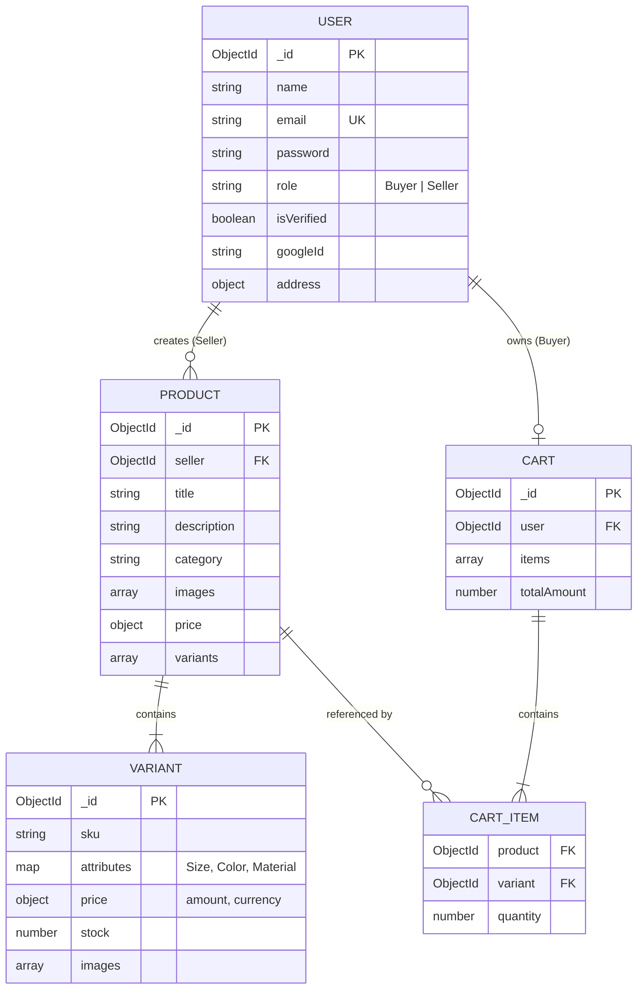

<div align="center">

# ⚜️ CLOTHINGG
### **A Full-Stack Multi-Vendor Fashion E-Commerce Platform**
#### *Final Year Capstone Project | B.Tech / B.E. in Computer Science & Engineering*

[](https://react.dev/)
[](https://react.dev/)
[](https://nodejs.org/)
[](https://expressjs.com/)
[](https://www.mongodb.com/)
[](https://tailwindcss.com/)
[](https://razorpay.com/)

<p align="center">
  A production-grade, full-stack multi-vendor e-commerce web application featuring Role-Based Access Control (RBAC), multi-attribute hierarchical product variant management, cloud CDN media pipelines, complex MongoDB aggregation cart calculations, and Razorpay payment integration.
</p>

[Project Abstract](#-project-abstract) • [Database Design](#-database-design--er-model) • [Module Implementation](#-module-wise-implementation) • [API Specification](#-restful-api-specification) • [Setup & Execution](#-setup--reproduction-guide)

</div>

---

## 🎓 Project Details

- **Project Title:** CLOTHINGG — Multi-Vendor Fashion E-Commerce Web System
- **Domain:** Web Application Engineering / Distributed Systems / E-Commerce
- **Architecture:** Client-Server RESTful Architecture (MERN Stack)
- **Developer:** Rudransh Khare
- **Academic Context:** Final Year Major Project / Capstone Submission

---

## 📄 Project Abstract

Traditional single-vendor e-commerce systems lack the flexibility required to host multiple independent merchants with heterogeneous product configurations. In modern fashion retail, a single garment often diverges into dozens of distinct Stock Keeping Units (SKUs) characterized by variable attributes (size, color, material), separate localized price points, and independent inventory levels.

**CLOTHINGG** addresses these challenges by implementing an enterprise-grade multi-vendor platform built with modern architectural principles:
1. **Multi-Tenant Role-Based Access Control (RBAC):** Strict operational segregation between **Sellers** (inventory managers) and **Buyers** (consumers) utilizing cryptographic JSON Web Tokens (JWT) stored in tamper-proof HttpOnly cookies alongside Google OAuth 2.0 federated identity.
2. **Dynamic Variant Data Engine:** A hierarchical data model in MongoDB supporting multi-image arrays, custom SKU attribute maps, and localized currency pricing.
3. **Optimized Aggregation Pipeline:** High-performance cart management that calculates sub-totals, discounts, and real-time inventory verification on the database layer.
4. **Idempotent Payment Gateway Integration:** Server-side order signing and client-side modal checkout powered by the Razorpay API.

---


## 🔬 Database Design & Schema Modeling

The database utilizes MongoDB's flexible document model to balance query performance with normalized relational integrity.



---

## 🧩 Module-Wise Implementation

### 1. Authentication & Security Engine
- **Hybrid Authentication:** Supports traditional credentials (with email verification via unique tokens) and one-click federated sign-in using **Google OAuth 2.0**.
- **Defense in Depth:** 
  - Passwords hashed using salted **bcrypt** algorithms.
  - JWTs issued and transmitted strictly via **HttpOnly, SameSite cookies** to prevent Cross-Site Scripting (XSS) and token theft.
  - Runtime request validation using **Zod** schemas to block injection attacks.
  - Role-based route middleware (`authenticateUser`, `authenticateSeller`) intercepting requests at the controller boundary.

### 2. Seller Hub & Dynamic SKU Inventory
- **Multi-Attribute Product Engine:** Allows merchants to generate root products with child variants possessing independent prices, inventory counters, and unique photo sets.
- **Media Pipeline:** Handles binary file uploads in memory via **Multer**, streaming buffers directly to **ImageKit CDN** for automated transformation, compression, and global edge delivery.
- **Inventory Lifecycle:** Real-time stock decrement, variant editing, and granular deletion cascades.

### 3. Buyer Fashion Storefront & UI Engineering
- **High-Aesthetic Editorial Design:** Built using **Tailwind CSS v4** and modern typography (`Montserrat` and `Cormorant Garamond`), ensuring a luxury boutique experience.
- **Smooth Micro-Interactions:** State transitions and interactive modals driven by **Framer Motion**.
- **Dynamic Product Inspector:** Client-side variant selector instantly swaps gallery previews, pricing currencies, and stock availability badges.

### 4. Real-Time Shopping Bag & Aggregation Engine
- **Slide-Over Interactive Drawer:** Persistent, responsive slide-out bag with live quantity counters (+/-) and smooth dismiss triggers.
- **MongoDB Aggregation Pipelines:** Replaces inefficient multi-query loops with atomic aggregation stages (`$match`, `$lookup`, `$unwind`, `$project`) to hydrate product variants and compute exact totals on the database server.
- **Optimistic State Management:** Redux Toolkit slices synchronize UI changes immediately while communicating asynchronous mutations with backend APIs.

### 5. Financial Transaction & Payment Module
- **Razorpay Integration:** Complete integration with India's leading payment gateway.
- **Secure Transaction Handshake:**
  1. Frontend dispatches checkout intent with verified subtotal.
  2. Backend validates cart items, creates an official Razorpay Order, and returns a signed `order_id`.
  3. Client launches Razorpay Checkout Modal populated with user contact details and the cryptographic order ID.
  4. Real-time transaction success callback and client alert handling.

---

## 🛠️ Technology Stack & Justification

| Layer | Technology | Version | Technical Justification |
| :--- | :--- | :--- | :--- |
| **Frontend Framework** | **React** | `^19.2` | Component modularity, Virtual DOM reconciliation, and Concurrent rendering. |
| **Build Tooling** | **Vite** | `^8.0` | Lightning-fast HMR (Hot Module Replacement) and ES-module native builds. |
| **Routing** | **React Router DOM** | `^7.18` | Declarative, nested routing with protected route guards for RBAC. |
| **Global State** | **Redux Toolkit** | `^2.12` | Predictable state container with normalized caching for cart and auth state. |
| **Styling** | **Tailwind CSS** | `^4.3` | Utility-first CSS reducing bundle footprint and enabling responsive layouts. |
| **Backend Runtime** | **Node.js** | `v18+` | Event-driven, non-blocking I/O model suited for high-concurrency e-commerce. |
| **API Framework** | **Express.js** | `^5.0` | Robust middleware ecosystem and native asynchronous route handling. |
| **Database** | **MongoDB Atlas** | `^8.10` | High-scalability NoSQL document store ideal for polymorphic product schemas. |
| **Authentication** | **JWT & Passport.js** | Latest | Stateless authentication coupled with standard OAuth 2.0 protocols. |
| **Validation** | **Zod** | `^3.24` | Type-safe schema declarations ensuring strict payload sanitization. |
| **Cloud CDN** | **ImageKit** | Latest | Offloads media asset serving, reducing server bandwidth and compute load. |
| **Payment Gateway** | **Razorpay** | `^2.9` | Secure payment compliance, webhooks, and sandbox testing support. |

---

## 📡 RESTful API Specification

### Authentication Subsystem (`/api/auth`)
| Method | Endpoint | Description | Auth Level |
| :--- | :--- | :--- | :--- |
| `POST` | `/api/auth/register` | Register new user account | Public |
| `GET` | `/api/auth/verify` | Verify email address token | Public |
| `POST` | `/api/auth/login` | Authenticate credentials & issue HttpOnly JWT | Public |
| `POST` | `/api/auth/forgot-password` | Dispatch tokenized password reset email | Public |
| `POST` | `/api/auth/reset-password` | Execute password reset using signed token | Public |
| `GET` | `/api/auth/getMe` | Retrieve active user profile from session | Authenticated User |
| `GET` | `/api/auth/google` | Initiate OAuth 2.0 redirection flow | Public |
| `GET` | `/api/auth/google/callback` | OAuth 2.0 authorization code exchange | Public |
| `POST` | `/api/auth/logout` | Clear session cookie and revoke access | Authenticated User |

### Product & Inventory Subsystem (`/api/products`)
| Method | Endpoint | Description | Auth Level |
| :--- | :--- | :--- | :--- |
| `POST` | `/api/products/add` | Publish new parent product with images | Seller Only |
| `POST` | `/api/products/:productId/variants` | Add attribute variant (SKU) to existing product | Seller Only |
| `GET` | `/api/products/sellerProduct` | Fetch catalog created by authenticated seller | Seller Only |
| `DELETE`| `/api/products/delete` | Delete product and associated variants | Seller Only |
| `GET` | `/api/products/getAllProducts` | Fetch all public inventory items with filters | Public |
| `GET` | `/api/products/DetailedProduct/:productId`| Fetch single product with nested variant schema | Public |

### Cart & Payment Subsystem (`/api/cart`)
| Method | Endpoint | Description | Auth Level |
| :--- | :--- | :--- | :--- |
| `POST` | `/api/cart/add/:productId` | Add base product to cart | Authenticated Buyer |
| `POST` | `/api/cart/add/:productId/:variantId` | Add specific variant SKU to cart | Authenticated Buyer |
| `GET` | `/api/cart/get` | Retrieve aggregated cart with calculated subtotal | Authenticated Buyer |
| `PATCH`| `/api/cart/quantity/increase/:productId/:variantId?`| Increment item quantity counter | Authenticated Buyer |
| `PATCH`| `/api/cart/quantity/decrease/:productId/:variantId?`| Decrement item quantity counter | Authenticated Buyer |
| `DELETE`| `/api/cart/remove/:productId/:variantId?` | Remove item from cart array | Authenticated Buyer |
| `POST` | `/api/cart/payment/create/order` | **Generate Razorpay cryptographic order ID** | Authenticated Buyer |

---

## 📂 Source Code Directory Organization

```
CLOTHINGG/
├── backend/
│   ├── src/
│   │   ├── config/              # Centralized environment configurations
│   │   ├── controller/          # Request-response controllers (Auth, Cart, Product)
│   │   ├── DAO/                 # Database Access Objects
│   │   ├── middleware/          # JWT authentication and Role guards
│   │   ├── model/               # Mongoose Schemas (User, Product, Price, Cart)
│   │   ├── routes/              # Express API route modules
│   │   ├── services/            # Microservices (ImageKit, Mailer, Razorpay)
│   │   ├── validation/          # Zod schema definitions
│   │   └── app.js               # Application setup & middleware bindings
│   ├── .env                     # Server environment variables
│   ├── package.json             # Backend dependencies
│   └── server.js                # Server listener entrypoint
└── frontend/
    └── clothingg/
        ├── public/              # Static branding and assets
        ├── src/
        │   ├── app/             # Application router & Layout wrappers
        │   ├── components/      # Reusable UI widgets & Protected Route wrappers
        │   ├── features/        # Feature-driven modular architecture
        │   │   ├── auth/        # Login, Register, Password Recovery, Slices
        │   │   ├── Cart/        # Cart Drawer, useCart Hook, Redux Slice, Cart API
        │   │   ├── products/    # Product creation, Variant manager, Detailed View
        │   │   └── User/        # Fashion catalog, Landing views, Buyer Profile
        │   ├── store/           # Redux Toolkit global store configuration
        │   ├── App.jsx          # Root component
        │   ├── index.css        # Tailwind CSS directives
        │   └── main.jsx         # DOM entrypoint
        ├── index.html           # HTML template with Razorpay Checkout SDK
        ├── package.json         # Frontend dependencies
        └── vite.config.js       # Vite build configurations
```

---

## 💻 Setup & Reproduction Guide

### Prerequisites
- **Node.js:** `v18.0.0` or higher
- **MongoDB:** Accessible MongoDB Atlas Connection String
- **Razorpay Account:** Test Key ID & Secret
- **ImageKit Account:** Public Key, Private Key & URL Endpoint
- **Google Cloud Console:** Client ID & Secret for OAuth 2.0

### Step 1: Backend Environment Configuration
Navigate to the `backend/` directory:
```bash
cd backend
npm install
```

Create a `.env` file in `backend/` with the following parameters:
```env
PORT=3000
MONGO_URL=mongodb+srv://<username>:<password>@cluster0.mongodb.net/CLOTHINGGG
JWT_TOKEN=your_cryptographically_secure_jwt_secret

# Mailer Credentials
GMAIL_USER=your_email@gmail.com
GMAIL_APP_PASSWORD=your_gmail_app_password
RESEND_MAIL=your_resend_api_key
MAIL_FROM=onboarding@resend.dev

# Google OAuth 2.0
GOOGLE_CLIENTID=your_google_client_id.apps.googleusercontent.com
GOOGLE_CLIENT_SECRET=your_google_client_secret

# ImageKit Storage CDN
ImageKitURLENDPOINTS=https://ik.imagekit.io/your_endpoint
ImageKit_Public_Key=your_public_key
ImageKit_Private_Key=your_private_key

# Razorpay Payment Gateway
RAZORPAY_KEY_ID=rzp_test_your_key_id
RAZORPAY_KEY_SECRET=your_razorpay_secret
```

Start the backend server:
```bash
npm run dev
```
*Backend runs on `http://localhost:3000`.*

---

### Step 2: Frontend Client Configuration
Navigate to the frontend application:
```bash
cd ../frontend/clothingg
npm install
```

*(Optional)* Create a `.env` file in `frontend/clothingg/`:
```env
VITE_RAZORPAY_KEY_ID=rzp_test_your_key_id
```

Start the client development server:
```bash
npm run dev
```
*Frontend will be hosted on `http://localhost:5173`.*

---

## 🧪 Testing & Demonstration Workflows (For Viva)

1. **Role-Based Registration & Login:**
   - Register a `Seller` account at `/register`. Verify email or sign in.
   - Access `/seller-home` to view the merchant dashboard. Confirm that `/buyer-home` routes remain protected.
2. **Product & Multi-Variant Publishing:**
   - Go to `/add-product` as a Seller. Upload high-res images and configure variants (e.g., Size: `M`, `L`, Color: `Black`, `Beige`, with distinct pricing and stock).
3. **Consumer Catalog & Cart Aggregation:**
   - Log in with a `Buyer` account. Browse `/buyer-products` and navigate to the product detail view.
   - Switch variants dynamically to observe real-time price and gallery switching.
   - Click **Add to Bag** to invoke the slide-over Cart Drawer. Test quantity incrementation and item deletion.
4. **Razorpay Payment Checkout:**
   - Click **Proceed to Secured Checkout** in the Cart Drawer.
   - Observe the backend generating an order via `/api/cart/payment/create/order`.
   - The interactive Razorpay modal launches, prefilled with the buyer's details, ready for test card/UPI payment completion.

---

## 🔮 Future Enhancements & Scope

- [ ] **AI-Powered Style Assistant:** LLM-powered conversational agent assisting buyers with personalized outfit matching and styling advice.
- [ ] **Payment Webhook Verification:** Full backend webhook ingestion verifying signature hashes to record finalized orders in an `Order` collection.
- [ ] **Multi-Currency Dynamic Conversion:** Real-time exchange rate API integration (USD, EUR, GBP, INR).
- [ ] **Full Production Deployment:** CI/CD pipeline targeting Docker containers, Vercel (Frontend), and Render (Backend).

---

## 👨‍🎓 Project Contributor & Student Info

- **Student Name:** Rudransh Khare
- **Degree:** Bachelor of Technology (B.Tech) — Computer Science & Engineering
- **GitHub:** [@kharerudransh](https://github.com/kharerudransh)
- **LinkedIn:** [Rudransh Khare](https://www.linkedin.com/in/rudransh-khare-55558233a)

---

<div align="center">
  <sub>Submitted in partial fulfillment of the requirements for the Degree of Bachelor of Technology in Computer Science & Engineering.</sub>
</div>
